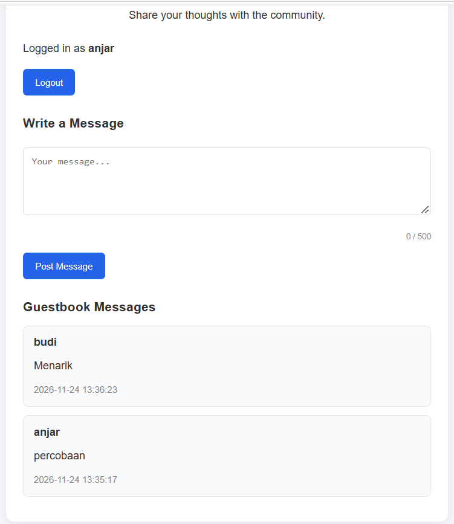
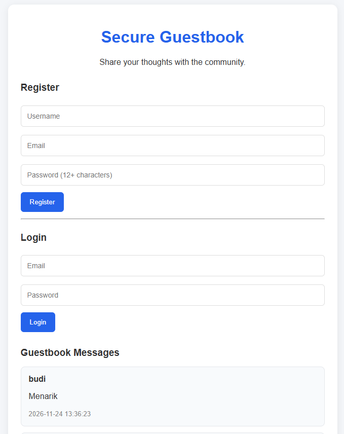

# Secure Guestbook

A simple full-stack guestbook application built with **Node.js, Express, SQLite, and vanilla HTML/CSS/JavaScript**.

This project demonstrates the fundamentals of web application development and application security, including user registration, authentication, session management, authorization, input validation, CSRF protection, and cloud deployment.

**Repository:** https://github.com/priandoyo/guestbook

## Application Screenshots

### Screenshot 1

### Screenshot 2

## 1. Project Overview

Secure Guestbook is a web application where visitors can read public messages, while registered and authenticated users can submit their own messages.

### Core Features

| Feature | Description |
|---|---|
| Registration | Create a new user account |
| Login | Authenticate using email and password |
| Public Guestbook | View existing messages without authentication |
| Authenticated Guestbook | Access posting functionality after login |
| Post Message | Submit a message of up to 500 characters |
| Success Confirmation | Display confirmation after successful submission |
| Logout | Terminate the authenticated session |

## 2. Technology Stack

| Component | Technology |
|---|---|
| Runtime | Node.js |
| Backend | Express.js |
| Database | SQLite |
| Database Library | better-sqlite3 |
| Password Hashing | bcrypt |
| Authentication | express-session |
| Session Storage | connect-sqlite3 |
| Security Middleware | Helmet |
| Rate Limiting | express-rate-limit |
| Frontend | HTML, CSS, JavaScript |
| Hosting | Render |
| Source Code | GitHub |

The application uses a deliberately simple architecture without React, ORM, Docker, or microservices.

## 3. Project Structure

\`\`\`text
guestbook/
├── server.js
├── db.js
├── auth.js
├── guestbook.js
├── package.json
├── .env.example
├── .gitignore
├── guestbook1.png
├── guestbook2.png
└── public/
    ├── index.html
    ├── app.js
    └── style.css
\`\`\`

## 4. Application Architecture

\`\`\`text
                 Web Browser
                      |
              HTML / CSS / JS
                      |
                    HTTPS
                      |
               Node.js / Express
                      |
          +-----------+-----------+
          |           |           |
       Helmet       Auth      Guestbook
                    Routes       Routes
          |           |           |
          +-----------+-----------+
                      |
                Session Layer
                      |
                 SQLite Database
                      |
             +--------+--------+
             |                 |
           Users             Messages
\`\`\`

### File Responsibilities

| File | Responsibility |
|---|---|
| server.js | Express application, middleware, sessions, CSRF, and startup |
| db.js | SQLite connection and table initialization |
| auth.js | Registration, login, current-user, and logout |
| guestbook.js | Public message retrieval and authenticated posting |
| public/index.html | Application interface |
| public/app.js | Frontend JavaScript and API integration |
| public/style.css | Application styling |
| package.json | Dependencies and execution scripts |
| .env.example | Example environment configuration |
| .gitignore | Excludes environment secrets and database files |

## 5. Database Design

The application initializes two SQLite tables.

### Users

| Field | Description |
|---|---|
| id | Primary key |
| username | User display name |
| email | Unique email address |
| password | bcrypt password hash |
| created_at | Account creation timestamp |

### Messages

| Field | Description |
|---|---|
| id | Primary key |
| user_id | Foreign key referencing users |
| message | Guestbook message |
| created_at | Message creation timestamp |

One user can submit multiple messages. Each message belongs to one registered user.

### Physical Database Files

\`\`\`text
data/
├── guestbook.db
└── sessions.sqlite
\`\`\`

- guestbook.db: User accounts and messages.
- sessions.sqlite: Express session records.

## 6. Security Controls

| Security Control | Implementation |
|---|---|
| Password Hashing | bcrypt |
| Authentication | Express Session |
| Session Regeneration | express-session |
| Authorization | requireAuth middleware |
| Session Cookie Security | HttpOnly, Secure, SameSite |
| CSRF Protection | Random session token |
| SQL Injection Prevention | Parameterized SQL |
| Input Validation | Server-side validation |
| XSS Mitigation | textContent |
| Rate Limiting | express-rate-limit |
| Security Headers | Helmet |
| Request Size Limit | Express JSON limit |

## 7. Local Installation

### Prerequisites

- Node.js
- npm
- Git (optional)

### Clone Repository

\`\`\`bash
git clone https://github.com/priandoyo/guestbook.git
cd guestbook
\`\`\`

### Install Dependencies

\`\`\`bash
npm install
\`\`\`

### Configure Environment

Copy .env.example to .env.

\`\`\`bash
cp .env.example .env
\`\`\`

For Windows PowerShell:

\`\`\`powershell
Copy-Item .env.example .env
\`\`\`

Example configuration:

\`\`\`env
PORT=3000
NODE_ENV=development
SESSION_SECRET=replace-with-a-long-random-secret
DATA_DIR=./data
\`\`\`

Generate a random secret:

\`\`\`bash
openssl rand -hex 32
\`\`\`

Never commit your actual .env file to GitHub.

### Start Application

\`\`\`bash
npm start
\`\`\`

For development:

\`\`\`bash
npm run dev
\`\`\`

Open http://localhost:3000.

## 8. Deployment to Render

Deploy the application as a Render Web Service.

### Web Service Configuration

| Setting | Value |
|---|---|
| Name | guestbook |
| Runtime | Node |
| Branch | main |
| Root Directory | Leave blank |
| Build Command | npm install |
| Start Command | npm start |

### Environment Variables

Configure these in Render → Environment.

| Key | Value |
|---|---|
| NODE_ENV | production |
| SESSION_SECRET | Generated random secret |
| DATA_DIR | Depends on storage option |

Render automatically provides PORT.

### Storage Option A — Render Free

Configuration:

\`\`\`text
DATA_DIR=./data
\`\`\`

The application stores SQLite files in its local filesystem.

The application works normally while the files are available, but Render Free does not provide persistent disk storage.

Important limitations:

- Data is not guaranteed to survive restarts.
- Data is not guaranteed to survive redeployment.
- Instance replacement can result in data loss.
- Free services can spin down after inactivity.

Suitable for workshops, temporary demonstrations, and experiments.

Do not use this storage option for important records.

### Storage Option B — Render Persistent Disk

Persistent disks allow SQLite files to survive supported application restarts and redeployments.

Configuration:

| Setting | Value |
|---|---|
| Disk Name | guestbook-data |
| Mount Path | /var/data |
| DATA_DIR | /var/data |

Resulting storage:

\`\`\`text
/var/data/
├── guestbook.db
└── sessions.sqlite
\`\`\`

Steps:

1. Upgrade to a Render plan supporting persistent disks.
2. Open Render → Disks.
3. Add a persistent disk.
4. Set the mount path to /var/data.
5. Configure DATA_DIR=/var/data.
6. Save and redeploy.

Persistent disks are a paid feature. Only files written under the mounted directory are persisted.

### Storage Option C — External PostgreSQL

An alternative is to use a managed PostgreSQL provider such as Neon.

https://neon.com/

Architecture:

\`\`\`text
Browser
   |
   v
Render Web Service
Node.js + Express
   |
   v
Managed PostgreSQL
Users + Messages
\`\`\`

Benefits:

- Database storage is independent of the Render filesystem.
- Data survives application redeployments and restarts.
- Database management and backups can be handled separately.

Important: The current application uses SQLite. Migrating to PostgreSQL requires database code changes. Changing DATA_DIR alone does not migrate the database.

## 9. Storage Comparison

| Characteristic | Render Free | Persistent Disk | PostgreSQL |
|---|---|---|---|
| Database | SQLite | SQLite | PostgreSQL |
| Storage | Ephemeral | Persistent | Separate managed service |
| Additional storage cost | No | Yes | Depends on provider |
| Survives redeployment | Not guaranteed | Yes | Yes |
| Survives restart | Not guaranteed | Yes | Yes |
| Code changes | None | Configuration | Migration required |

### Understanding Compute and Storage

- Render Web Service provides compute resources.
- SQLite provides the database engine.
- Render Persistent Disk provides persistent file storage.
- Managed PostgreSQL provides a separate database service.

A running application does not automatically mean its local data is permanent.

## 10. API Reference

| Method | Endpoint | Access | Description |
|---|---|---|---|
| GET | /api/csrf | Session | Get CSRF token |
| POST | /api/auth/register | Public | Register account |
| POST | /api/auth/login | Public | Authenticate user |
| GET | /api/auth/me | Public | Retrieve current user |
| POST | /api/auth/logout | Session | Logout |
| GET | /api/messages | Public | List messages |
| POST | /api/messages | Authenticated | Create message |

State-changing requests require a valid X-CSRF-Token header.

## 11. Workshop Practical Exercises

| No. | Exercise | Security Concept |
|---|---|---|
| 1 | Register an account | Password hashing |
| 2 | Inspect the database | Data storage |
| 3 | Login and inspect cookies | Session management |
| 4 | Attempt posting without login | Authorization |
| 5 | Submit an invalid CSRF token | CSRF protection |
| 6 | Submit HTML/script as a message | XSS prevention |
| 7 | Try SQL injection in login fields | SQL injection prevention |
| 8 | Submit oversized messages | Input validation |
| 9 | Redeploy the free service | Ephemeral storage |
| 10 | Configure a persistent disk | Storage persistence |

Only perform security tests against systems you own or have permission to test.

## 12. Learning Outcomes

After completing this project, participants should understand:

- Full-stack web application architecture.
- Frontend and backend responsibilities.
- HTTP requests and API endpoints.
- Password hashing and authentication.
- Session-based authentication.
- Authentication versus authorization.
- CSRF and XSS prevention.
- SQL injection prevention.
- Cloud application deployment.
- Compute versus storage.
- Ephemeral versus persistent storage.
- Local databases versus managed cloud databases.

## 13. Project Information

**Project:** Secure Guestbook  
**Language:** JavaScript  
**Runtime:** Node.js  
**Framework:** Express.js  
**Database:** SQLite  
**Deployment:** Render  
**Purpose:** Application development and security workshop reference

**Disclaimer:** This application is intended for educational use. Additional security hardening, operational controls, monitoring, and backup procedures are required before production use.
