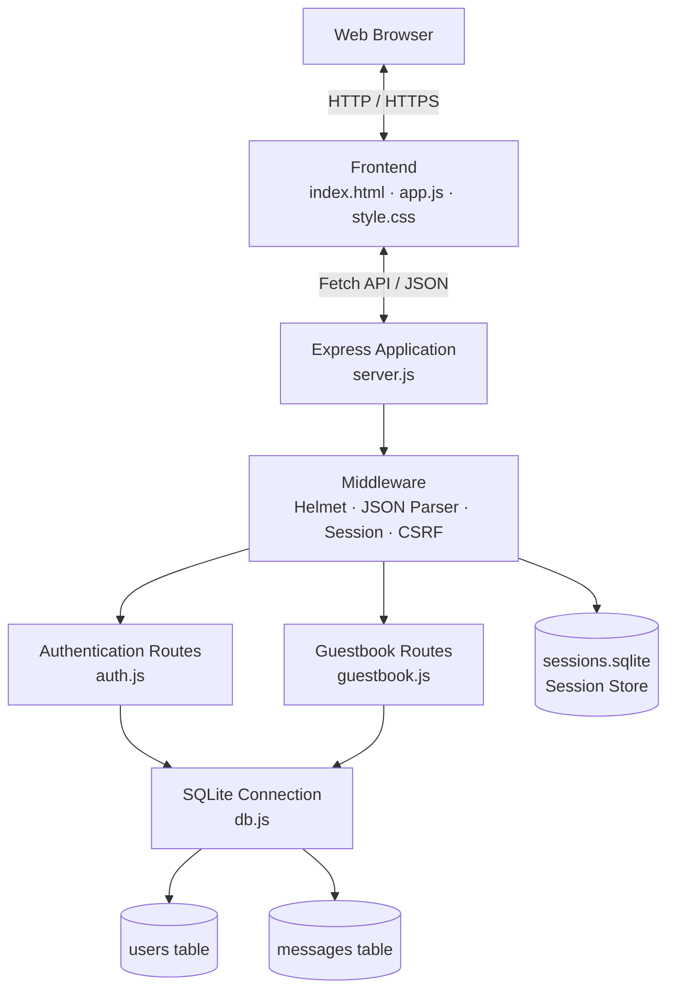
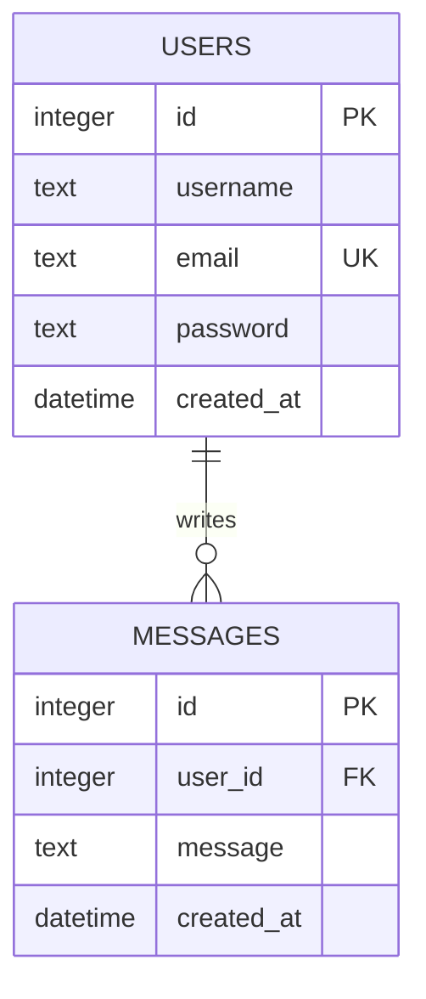

# Secure Guestbook

A simple full-stack guestbook application built with **Node.js, Express, SQLite, and vanilla HTML/CSS/JavaScript**.

This project is a practical workshop reference for web development, authentication, session management, authorization, application security, and cloud deployment.

**Repository:** https://github.com/priandoyo/guestbook

## Application Screenshots

### Screenshot 1


### Screenshot 2


---

## 1. Project Overview

Visitors can read public messages. Registered and authenticated users can post messages.

| Feature | Description |
|---|---|
| Registration | Create an account with username, email, and password |
| Login | Authenticate with email and password |
| Public guestbook | Read existing messages without logging in |
| Protected posting | Only authenticated users can submit messages |
| Success confirmation | Confirm successful posting and refresh messages |
| Logout | End the current authenticated session |

The application is intentionally small: no React, ORM, Docker, or microservices are required.

## 2. Technology Stack

| Layer | Technology | Purpose |
|---|---|---|
| Runtime | Node.js | Runs server-side JavaScript |
| Web framework | Express | HTTP server, middleware, and routes |
| Database | SQLite / better-sqlite3 | Stores users and messages |
| Password hashing | bcrypt | Stores password hashes, not plaintext passwords |
| Authentication session | express-session | Maintains login state |
| Session store | connect-sqlite3 | Stores session records in SQLite |
| Security headers | Helmet | Sets HTTP security headers |
| Rate limiting | express-rate-limit | Limits repeated authentication attempts |
| Frontend | HTML, CSS, vanilla JavaScript | User interface and API calls |
| Hosting | Render Web Service | Runs the Node.js application |
| Source control | GitHub | Stores source code and supports deployments |

## 3. Project Structure

```text
guestbook/
├── server.js
├── db.js
├── auth.js
├── guestbook.js
├── package.json
├── .env.example
├── .gitignore
├── guestbook1.png
├── guestbook2.png
└── public/
    ├── index.html
    ├── app.js
    └── style.css
```

### File Responsibilities

| File | Responsibility |
|---|---|
| server.js | Express setup, middleware, sessions, CSRF, routes, and startup |
| db.js | SQLite connection, data directory, and table initialization |
| auth.js | Registration, login, password hashing, current-user, and logout |
| guestbook.js | Public message listing and authenticated message creation |
| public/index.html | User interface structure |
| public/app.js | Browser-side API integration |
| public/style.css | Application styling |
| package.json | Dependencies and npm commands |
| .env.example | Example environment configuration |
| .gitignore | Excludes secrets and database files |

## 4. Application Architecture

The browser displays the frontend and sends HTTP requests to Express. Express applies middleware, then routes each request to the relevant handler. The route handlers access SQLite through the database module.



### Request Flows

**Registration and login**

1. The browser submits credentials to an authentication endpoint.
2. Express middleware parses the request and validates the CSRF token.
3. auth.js validates inputs and creates or verifies the account.
4. bcrypt hashes or verifies the password.
5. A new session is generated and the authenticated user is recorded.
6. The browser receives the session cookie.

**Public message viewing**

1. Browser requests GET /api/messages.
2. guestbook.js queries SQLite.
3. The server returns up to 50 messages.
4. The frontend renders the message content as text.

**Protected message posting**

1. Browser obtains a CSRF token from GET /api/csrf.
2. Browser submits POST /api/messages with the token and message.
3. CSRF middleware validates the token.
4. requireAuth verifies the authenticated session.
5. The guestbook route validates and inserts the message.
6. The browser displays confirmation and refreshes the message list.

## 5. Database Design

The application initializes two application tables.

### Users

| Column | Meaning |
|---|---|
| id | Primary key |
| username | Public display name |
| email | Unique, normalized email address |
| password | bcrypt password hash |
| created_at | Account creation timestamp |

### Messages

| Column | Meaning |
|---|---|
| id | Primary key |
| user_id | Foreign key referencing users.id |
| message | Message content |
| created_at | Message creation timestamp |

One user can write many messages. Each message belongs to one user.



### Physical SQLite Files

```text
<DATA_DIR>/
├── guestbook.db
└── sessions.sqlite
```

- guestbook.db: User accounts and messages.
- sessions.sqlite: Express session records.

These are separate SQLite files with different responsibilities.

## 6. API Reference

| Method | Endpoint | Access | Description |
|---|---|---|---|
| GET | /api/csrf | Session | Returns CSRF token |
| POST | /api/auth/register | Public | Register account |
| POST | /api/auth/login | Public | Authenticate user |
| GET | /api/auth/me | Public session | Retrieve current user |
| POST | /api/auth/logout | Session | Logout |
| GET | /api/messages | Public | List latest 50 messages |
| POST | /api/messages | Authenticated | Create message |

State-changing requests require a valid X-CSRF-Token header.

## 7. Security Controls

| Control | Implementation | Purpose |
|---|---|---|
| Password hashing | bcrypt | Avoids plaintext password storage |
| Authentication | Express sessions | Maintains authenticated identity |
| Session regeneration | auth.js | Reduces session fixation risk |
| Authorization | requireAuth middleware | Restricts posting |
| Session cookie flags | HttpOnly, Secure in production, SameSite=Lax | Hardens cookie handling |
| CSRF protection | Random session token | Checks state-changing requests |
| Parameterized SQL | Prepared statements | Separates SQL structure from input |
| Input validation | Server-side checks | Enforces accepted values |
| XSS mitigation | textContent | Renders message text safely |
| Rate limiting | express-rate-limit | Limits repeated login and registration attempts |
| Security headers | Helmet | Sets HTTP security headers |
| Request size limit | Express JSON limit | Limits JSON payload size |

## 8. Local Installation

### Prerequisites

- Node.js
- npm
- Git (optional)

### Clone and install

```bash
git clone https://github.com/priandoyo/guestbook.git
cd guestbook
npm install
```

### Configure environment variables

Copy .env.example to .env.

```bash
cp .env.example .env
```

Windows PowerShell:

```powershell
Copy-Item .env.example .env
```

Example configuration:

```dotenv
PORT=3000
NODE_ENV=development
SESSION_SECRET=replace-with-a-long-random-secret
DATA_DIR=./data
```

Generate a random secret:

```bash
openssl rand -hex 32
```

Never commit your actual .env file to GitHub.

### Start application

```bash
npm start
```

For development:

```bash
npm run dev
```

Open http://localhost:3000.

## 9. Deployment to Render

Deploy the
